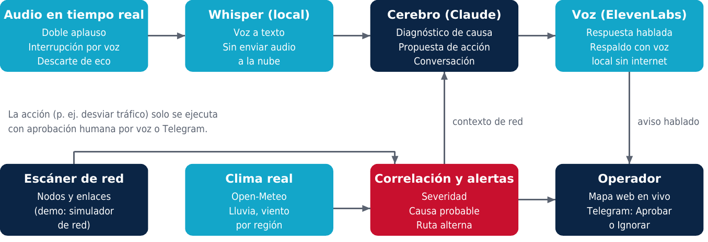
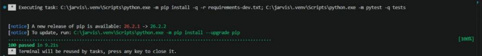
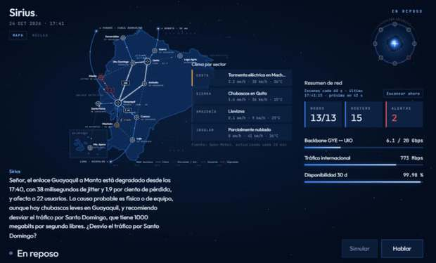

# Sirius: IA y voz para operar redes de telecomunicaciones

**BAD Day 2026 · Categoría: Software y Sistemas Computacionales**

Sirius es un asistente de operación de red con inteligencia artificial y voz. Vigila los nodos y enlaces, cruza su estado con el clima en tiempo real, explica la causa probable de una falla, avisa en voz alta y propone una acción que el operador aprueba con su voz o desde el celular.

> **Sobre el código fuente.** Este es el repositorio público de la entrega: documentación técnica, arquitectura, resultados de pruebas e informe. El código del motor de Sirius está en un repositorio privado porque el proyecto está orientado a una futura comercialización. El equipo puede dar **acceso de lectura temporal** a los miembros del jurado que lo soliciten (indicando su usuario de GitHub) y lo mostrará en vivo durante el BAD Day.

---

## El problema

En una red de telecomunicaciones, la degradación de un enlace troncal por lluvia, viento o una falla de energía en un nodo puede tardar en detectarse y escalarse. El monitoreo tradicional depende de que un operador vea la alerta en pantalla, interprete la causa y decida qué hacer. Las alarmas además llegan sin contexto: hay que cruzar a mano el estado de la red con el clima de la zona. Cada minuto sin servicio afecta a clientes, acuerdos de nivel de servicio (SLA) y reputación.

## La solución

Sirius corre en el computador del centro de operaciones y:

- **Escanea periódicamente** los nodos y enlaces de la red.
- **Correlaciona** cada evento con datos meteorológicos reales (lluvia y viento por región) para explicar la causa probable.
- **Avisa en voz alta** solo lo que importa, con la causa y una acción propuesta. Por ejemplo: *"El enlace Guayaquil–Manta está degradado, probablemente por lluvia intensa en la Costa. ¿Desvío el tráfico por Santo Domingo?"*
- **Ejecuta solo con aprobación humana**, por voz ("sí, desvíalo") o con los botones Aprobar e Ignorar en Telegram.
- **Conversa en lenguaje natural**: "¿cómo está la red?", "¿y Loja?". Se puede interrumpir mientras habla ("para", "sigue").
- **Sigue operando sin internet**, con el último escaneo y voz local.
- **Se activa con doble aplauso** o con la barra espaciadora.

## Arquitectura

| Componente | Función | Tecnología |
| --- | --- | --- |
| Audio en tiempo real | Doble aplauso, interrupción por voz, descarte del propio eco | Python, sounddevice, procesamiento de señal |
| Reconocimiento de voz | Voz a texto **local**, sin enviar audio a la nube | Whisper (faster-whisper) |
| Cerebro | Diagnóstico de causa, propuesta de acción, conversación | Modelo de lenguaje Claude (API de Anthropic) |
| Voz | Respuesta hablada, con respaldo de voz local sin internet | ElevenLabs / voz del sistema |
| Escáner de red | Estado de nodos y enlaces | Módulo propio (en la demo, simulador de red) |
| Clima | Lluvia y viento por región en tiempo real | API de Open-Meteo |
| Operador | Mapa web en vivo y alertas móviles con aprobación | HTML/CSS/JavaScript, Telegram Bot API |

### Decisiones técnicas

- **Whisper local**: menor latencia, privacidad y funcionamiento con conectividad degradada.
- **Aprobación humana obligatoria**: el modelo propone, el operador decide. Ninguna acción sobre la red se ejecuta sola.
- **Degradación controlada**: sin internet usa el último escaneo, voz local y clima simulado; sin Telegram sigue por voz y mapa.
- **Seguridad**: claves en un archivo local fuera del control de versiones, Telegram restringido a un único chat autorizado, límite de tamaño a notas de voz y dependencias revisadas sin vulnerabilidades conocidas.

## Resultados

| Indicador | Resultado medido |
| --- | --- |
| Pruebas automáticas | 100 pruebas, todas aprobadas (24 de octubre de 2026, 9,2 s) |
| Revisiones de seguridad y lógica | 2 revisiones: 0 hallazgos graves; 9 menores corregidos |
| Estabilidad continua | 10 h y 14 h sin bloqueos; memoria estable, sin fugas |
| Tolerancia a fallas | Sobrevivió cortes de internet; sin conexión responde con el último escaneo |
| Tiempo de respuesta por voz | De 12–15 s a cerca de 8 s |
| Activación por doble aplauso | 4 de 4 pares detectados; 0 activaciones falsas al hablar |
| Interrupción por voz | "para" detiene, "sigue" retoma; no se corta con su propio eco |
| Flujo de alerta completo | Falla simulada → aviso hablado → aprobación → desvío confirmado |
| Telegram | Estado, texto, notas de voz y botones Aprobar e Ignorar operativos |

**Alcance de la demo:** la red de nodos y enlaces es simulada (Costa, Sierra y Amazonía de Ecuador); el clima es real. Las alertas por WhatsApp y llamada telefónica están diseñadas pero simuladas, porque requieren un servicio de pago.

## Evidencias

*Ejecución de la suite automática, 24 de octubre de 2026.*

*Sirius detecta la degradación del enlace Guayaquil–Manta, la cruza con el clima real y propone desviar el tráfico por Santo Domingo, 24 de octubre de 2026.*

## Próximos pasos

1. Conectar Sirius a equipos reales en modo de solo lectura (ping).
2. Validar la instalación en un segundo computador.
3. Empaquetarlo como ejecutable para Windows.
4. Habilitar WhatsApp y llamadas de escalamiento.

## Documentos

- [Informe del proyecto (PDF)](docs/Sirius_Informe_BAD_Day_2026.pdf)
- Video de la demostración y capturas: carpeta [`media/`](media/)

## Equipo

| Integrante | Rol |
| --- | --- |
| [] | [Desarrolladora única del proyecto] |

---

© 2026 Equipo Sirius. Todos los derechos reservados. Este repositorio contiene únicamente documentación del proyecto; su contenido no se ofrece bajo licencia de código abierto.
